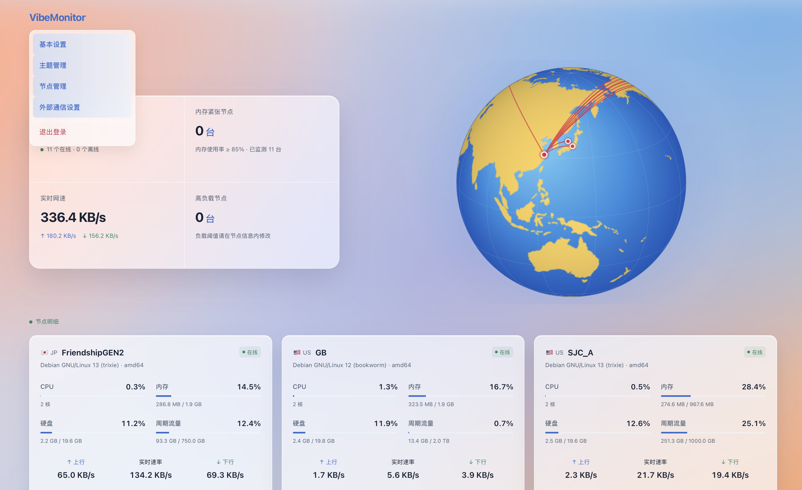
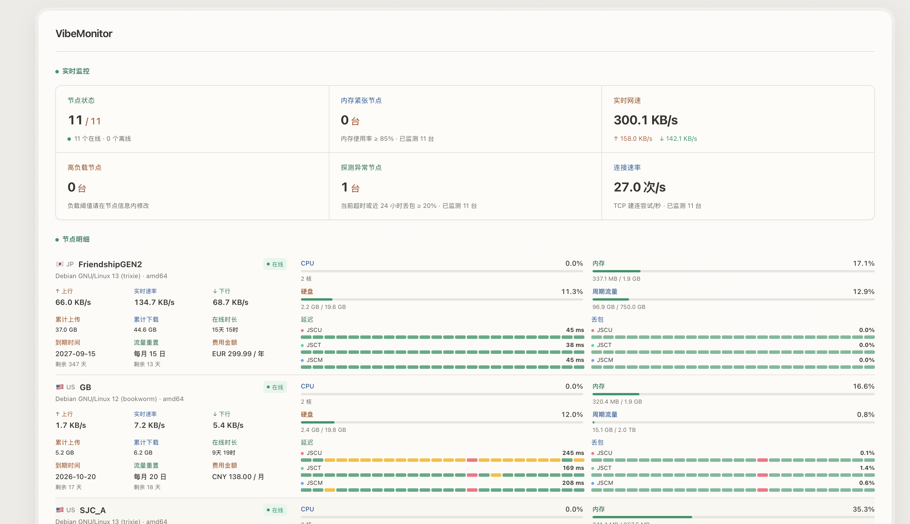
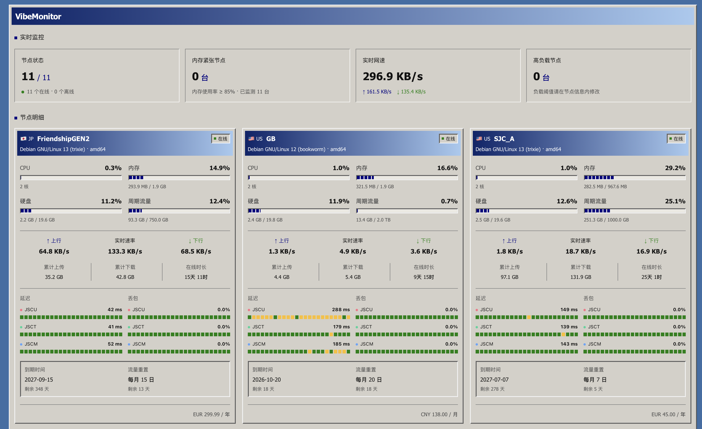
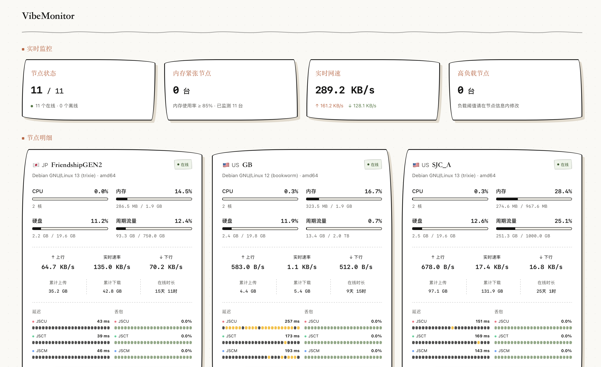

# VibeMonitor

面向 IPv4 与 Linux x86-64/ARM64 的轻量服务器监控面板。主控是单个 Go 二进制加单个 SQLite 文件，前端静态文件全部内嵌，部署只有 systemd 和一个数据文件；探针主动连主控上报，不监听任何端口。

## 功能

### 实时总览

- 六项汇总：在线节点数、高负载节点、内存紧张节点（内存 ≥ 85%）、实时网速、周期流量、TCP 连接速率；
- 地球仪按节点地区从上海连线，可拖动旋转；
- 节点卡片显示 CPU、内存、硬盘、周期流量、实时速率，并逐个列出测试目标的当前延迟（超时、待上报单独标注）；
- 每个节点可单独设置 CPU 负载阈值，未设置阈值的节点不计入高负载统计。

### 流量与账期

- 账单周期与流量统计，首个周期可自定义已使用流量；每个节点可设置月流量配额与每月重置日（1–31）；
- 周期流量显示日流量柱形图，按节点重置日查询当前周期、上一个周期或当前及前两个周期；
- 上传与下载合计，跨日采样按时间分摊，账期与每日汇总统一使用 UTC+8，未采集流量按 0 计算；
- 柱形颜色区分全天在线、全天离线、部分离线及状态未知；
- 日流量汇总保留 180 天，不含手动补录或校正，历史从升级后开始采集。

### 历史曲线

- 资源名称旁的折线图标（CPU、内存、硬盘、周期流量、实时速率）表示可点击查看履历；
- CPU、内存和硬盘使用率支持最近 1 小时、24 小时、7 天和 31 天查询，硬盘历史从升级后收到的采样开始记录；
- 延迟波动曲线按测试目标绘制，实时速率曲线与之同款；
- 采样历史保留 90 天。

### 排行榜

- 网站标题菜单里的「排行榜」对访客开放：日榜、周榜、月榜分别统计北京时间今天、本周（周一起）、本月至今，每项取前三名；
- 五项指标：连接数量、系统负载、内存占用、建连速度、流量；离线节点凭时段内已有记录参与，缺少记录的节点不参与。

### 告警

- 通过 Telegram Bot 推送：节点离线与恢复、CPU（按节点阈值）、内存（85%）、流量超额、流量提前预警、到期提醒；
- 流量预警按配额百分比设置，达到比例时提前提醒，每个账期最多一次；0 或留空关闭，原有超额报警保留，需设置流量配额并开启 Telegram 告警；
- 到期提醒可设提前天数（0–7 天）、每日提醒时间（0–23 时）与提醒时区；
- 离线告警阈值（秒）可调；每个节点可单独关闭告警；七类报警文案均可自定义，变量在发送时替换。

### 节点管理

- 可添加、编辑或删除节点，维护名称、地区（国旗代码）、测试目标、到期日、付款周期、金额与币种；节点按自定义顺序排序；
- 测试目标按「名称,地址:端口」逐行填写，支持 tcp://、http://、https:// 链接（只测 TCP 连接，不请求网页）；
- 在「节点管理 → 编辑现有节点」表单顶部显示「主控版本 / 节点版本」：探针低于主控时标注可升级，尚未上报版本的老探针显示「未上报」；
- 修改重置日导致账期起点变化时，会按新账期已采集日流量重算并清除旧账期的手动补录，需要时可同时校正「当前周期已用流量」；只编辑名称等信息不改变原配额。

### 探针注册与安装

- 探针安装命令在「节点管理 → 节点列表」每行的「接入命令」中获取；
- 临时注册窗口默认开放 60 分钟、最长 24 小时，到期自动失效，不需要后台任务；密钥为 32 位十六进制，同一来源地址 5 分钟内最多注册 10 次；
- 节点名默认取目标机器主机名，可用 `-n` 指定别的名字；主控已有同名节点时返回 `409`，安装器会提示先删除旧节点或用 `-n` 重命名（判重不区分大小写）；
- 安装脚本自动配置 Nginx HTTP 反向代理、申请 HTTPS 证书并启用自动续期。

### 外观与安全

- 单用户管理员登录：点网站标题打开管理菜单，未登录时点任一管理项会先弹出登录对话框，登录后进入对应页面（`/admin/nodes`、`/admin/settings`、`/admin/theme`、`/admin/telegram`）；
- 「基本设置」可改网站名称、地址栏图标（PNG/JPG/SVG/WebP/ICO/GIF，最大 2MB，存数据库）与管理员密码；
- 「主题管理」内置 Design 默认主题，支持上传、选择、删除自定义 CSS 主题包（`theme.json` 加一个 CSS 文件，最多 32 个，包内不允许 JavaScript）；主题影响管理入口时在网址加 `?theme=default` 可临时以默认外观打开；
- 管理页与写接口都要求管理员会话：未登录访问 `/admin/*` 会被 302 送回监控面板（页面本身不下发），会话在页面打开期间失效时管理页也会退回首页，公共首页不含管理脚本；
- 无插件，不提供远程控制或文件管理。

## 性能与资源占用

| 项目 | 实测 / 设定 |
| --- | --- |
| 二进制 | 单个静态文件：amd64 12.3 MB、arm64 11.8 MB（`make release-all`，`CGO_ENABLED=0` + `-s -w`）。主控与探针是同一个二进制，用子命令区分 |
| 主控内存 | Go 堆实测：空载 2 MiB，200 个节点各上报 30 轮后 3.8 MiB；进程 RSS 空载 15–22 MiB（取决于是否已承载 HTTP/WebSocket 连接） |
| 探针内存 | systemd 限制 `GOMEMLIMIT=25MiB`、`MemoryHigh=64M`、`MemoryMax=128M` |
| 前端 | 358 KB 静态文件全部内嵌，无 Node 构建步骤；首页首屏 13 个文件 167 KB，gzip 后 43 KB，地球底盘与地区数据另 83 KB（gzip 后 33 KB，仅首次加载） |
| HTTP | 全站 gzip（图片、字体等已压缩类型跳过），静态资源带 ETag 与 304 |
| 实时推送 | WebSocket 每 3 秒一帧，内容未变化则不发送；仪表盘视图不带 `history` 数组。200 节点单帧 408 KiB（完整视图 1034 KiB），同帧 gzip 参考值 18 KiB / 26 KiB；当前帧未协商 permessage-deflate，实际以未压缩大小发送 |
| 存储 | 纯 Go SQLite（WAL、`synchronous=NORMAL`、`busy_timeout=5s`），单写连接加最多两个只读连接；历史批量事务写入，写失败保留重试（上限 65,536 条），清理任务每 15 分钟 |
| 保留策略 | Ping 与资源采样 90 天，日流量 180 天 |
| 页面 | 未变化的卡片复用已有 DOM；标签页进入后台时停止渲染与兜底轮询，回到前台刷新 |
| 探针 | 默认 1 秒上报，基本信息每 15 分钟刷新；只发起出站连接，不监听端口；systemd 沙箱（`NoNewPrivileges`、`ProtectSystem=strict`、`ProtectHome`、`PrivateTmp`、`PrivateDevices`、`RestrictAddressFamilies`，仅保留 `CAP_NET_RAW` 供 ping 使用）；自身不写状态文件，凭据由 root 级 `EnvironmentFile` 提供 |

内存与帧大小为本地等量建模实测（200 节点 × 每节点 4 个测试目标 × 30 轮上报，真实 SQLite 文件与真实 HTTP 服务，无浏览器与反向代理连接）；实际部署随节点数、在线访客数与反代配置变化，增长趋势一致。

## 界面预览






## 安装与更新

支持 Linux x86-64 / ARM64，使用 systemd。运行安装脚本后，选择 **1. 安装主控**；以后更新主控选择 **2. 更新主控**，会保留账号、节点和历史数据。

```bash
curl -4 -fsSL -o install.sh https://raw.githubusercontent.com/M48A1/vibemonitor/main/install.sh && bash install.sh
```

安装主控时填写域名，脚本会配置 Nginx HTTP 反向代理、申请 HTTPS 证书并启用自动续期。留空域名时使用原有的直接端口访问方式。探针填写最终的主控访问地址。

## 运维与开发

数据库位置、探针参数、流量账期规则、反向代理和测试命令见 [运维与开发指南](docs/operations.md)。
